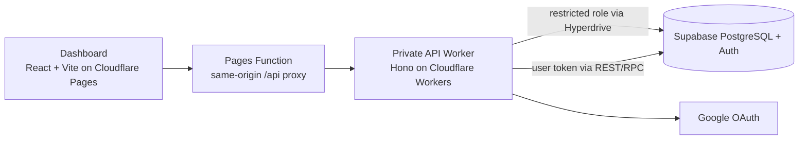

# Paced

Paced is an invite-only web application for planning careful LinkedIn outreach. Users save selected prospects into lists, write a connection note and follow-up messages, review the exact text each person would receive, and approve a sequence before anything can run. The dashboard and campaign data are hosted centrally. Any future LinkedIn interaction is designed to happen only in the user's own signed-in browser, never from a cloud browser.

> **Status: private pilot, sending disabled.** The hosted app currently works with fictional sample data only. Importing from LinkedIn, detecting replies and sending invitations or messages are **not implemented**. See [Project status](#project-status).

## Contents

- [Features](#features)
- [Architecture](#architecture)
- [Repository layout](#repository-layout)
- [Getting started](#getting-started)
- [Testing](#testing)
- [Database](#database)
- [Deployment](#deployment)
- [Project status](#project-status)
- [Security](#security)
- [Documentation](#documentation)

## Features

- **Owner-approved access.** Google sign-in, with an administrator allowlist that controls who gets a workspace.
- **Prospects and lists.** Import from a fixed fictional catalog, with a preview step and duplicate detection. Each account holds at most 1,000 saved prospects.
- **Campaign drafts.** An optional invitation note, a first message and up to three follow-ups with configurable delays. Supports `{{name}}`, `{{company}}` and `{{role}}` placeholders. Missing values block approval instead of being invented.
- **Exact approval.** The approval screen renders every recipient's final text. Any later edit cancels the approval.
- **Safe sequence states.** Existing connections are excluded and pending invitations wait. Unknown state is held for verification. A confirmed rejection or withdrawal stops the sequence. Only one active sequence is allowed per account and recipient.
- **Campaign controls.** Pause, resume for review and stop all persist on the server. A failed request is never reported as successful.
- **Data ownership.** Users can download a complete export of their workspace or permanently delete it after a fresh sign-in.
- **Quota guards.** Database size, request and egress meters warn at 60% of free-tier limits and block growth at 70%. Pause, stop, export and delete always remain available.

## Architecture



- **Dashboard** (`apps/dashboard`): a React and TypeScript single-page app built with Vite.
- **API** (`apps/api`): a Hono application on Cloudflare Workers. It is reachable only through the Pages service binding, with no public `workers.dev` endpoint.
- **Sessions**: an opaque `HttpOnly` cookie. Provider tokens are encrypted server-side and never reach browser JavaScript. Every mutation requires a CSRF token.
- **Data access**: product data is read and written with the signed-in user's own token. Row-level security checks workspace ownership, active admission and a live session. The Worker's database role can only call a small set of session functions.
- **Campaign engine** (`packages/campaign-engine`): pure, deterministic state transitions with no dependency on storage, browsers or cloud services.

Design records live in [`docs/architecture`](docs/architecture/README.md) and [`docs/decisions`](docs/decisions/README.md).

## Repository layout

```text
apps/
  api/                 Hono API: Worker entry, auth, management, export/delete, usage
  dashboard/           React dashboard, Pages Function proxy and security headers
packages/
  campaign-engine/     Pure campaign state machine and eligibility rules
  shell-contracts/     Shared request/response schemas (zod)
tools/
  campaign-simulator/  CLI and local visual demo driven by synthetic events
  local-shell/         Local launcher for the fixture dashboard and API
supabase/
  migrations/          Ordered, checksummed SQL migrations
  tests/               Synthetic fixtures for integration tests
scripts/               Migration runner, operator tools, database integration suite
tests/                 Python unit tests for the scripts
docs/                  Architecture, decisions, engineering and product notes
```

## Getting started

### Prerequisites

- Node.js 26.10.x (see `.node-version`) and npm
- Python 3.10 or later
- `psql` with TLS `verify-full` support, needed only for database work

### Install

```bash
npm ci --ignore-scripts
```

### Run locally

The local shell serves the dashboard against built-in fictional fixtures. It needs no cloud account.

```bash
npm run dev        # dashboard + API on 127.0.0.1, ports printed at startup
npm run demo       # visual campaign simulator
npm run simulate -- --list
npm run simulate -- unknown-restart
```

The hosted sign-in flow is built with `VITE_HOSTED_AUTH=1`. It needs the deployed Worker and is not served by the local shell.

## Testing

```bash
npm run typecheck
npm test                                  # Vitest: engine, API and dashboard
npm run format:check                      # Prettier
VITE_HOSTED_AUTH=1 npm run build          # hosted dashboard bundle
python3 -m unittest discover -s tests -v  # script guards
```

Database integration tests run against a dedicated, disposable test project. They are kept separate from `npm test`. See [Database](#database).

## Database

Two Supabase projects are used: `development` for the hosted app, and an isolated `test` project for destructive integration tests. Migrations are plain SQL under `supabase/migrations`. A custom runner applies them in order, records a SHA-256 checksum for each one and refuses changed files. Fix mistakes with a new forward migration and never edit an applied one.

Credentials are read from ignored local files under `.local/` and are never committed.

```bash
python3 scripts/database.py check   --target test
python3 scripts/database.py migrate --target test
python3 scripts/test_database.py --confirm-test-project <test-project-ref>
python3 scripts/database.py migrate --target development   # only after the test suite passes
```

Operator tools:

```bash
python3 scripts/pilot_access.py inspect --target development --user <uuid>
python3 scripts/pilot_meters.py show    --target development
```

More detail is in the [database guide](docs/engineering/database.md).

## Deployment

The API Worker and the dashboard deploy separately with Wrangler. Set `CLOUDFLARE_ACCOUNT_ID` in your shell.

```bash
cd apps/api && npx wrangler deploy
cd apps/dashboard && npx wrangler pages deploy dist --branch main
```

Worker secrets are managed with `wrangler secret`: token encryption keys, the CSRF secret and the IP hash secret. Never put them in configuration files.

## Project status

| Area | State |
| --- | --- |
| Google sign-in, admission, sessions, revocation | Done, hosted |
| Prospects, lists, drafts, approval, pause/stop (fictional data) | Done, hosted |
| Export, workspace deletion, quota meters | Implemented and tested, release pending |
| Encrypted off-site backups and restore drill | Planned |
| Monitoring, incident runbook, accessibility review | Planned |
| Regional load test (India and North America) | Planned |
| Browser extension: read LinkedIn pages | Not started; feasibility unproven |
| Sending invitations and messages | Not started; disabled by design |

LinkedIn's user agreement restricts automated activity. Any future browser integration needs to be checked against that policy and tested with explicitly approved recipients and content.

## Security

- No secrets are stored in this repository. Local credentials live in the ignored `.local/` directory, and deployed secrets live in the provider's secret store.
- Database roles follow least privilege, and every tenant table has row-level security.
- Please report security concerns privately to the repository owner rather than opening a public issue.

## Documentation

| Topic | Location |
| --- | --- |
| Product scope | [docs/product/brief.md](docs/product/brief.md) |
| Architecture overview | [docs/architecture/README.md](docs/architecture/README.md) |
| Architecture decision records | [docs/decisions/README.md](docs/decisions/README.md) |
| Database workflow | [docs/engineering/database.md](docs/engineering/database.md) |
| Export file format | [docs/engineering/export-format.md](docs/engineering/export-format.md) |

## License

Private repository. All rights reserved.
