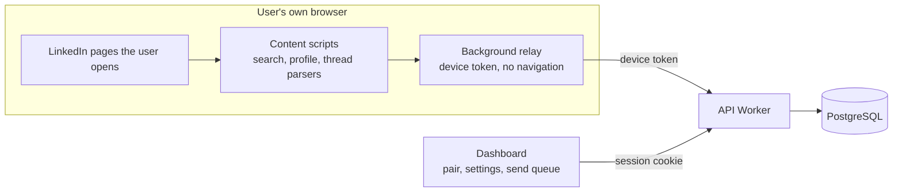

# Assisted outreach from the user's own browser

Status: slice 1 (browser pairing and user-triggered observation) implemented on 4 November 2026; slice 2 (manual send queue) implemented on 5 November 2026. Sending remains disabled until the implementation status section says otherwise.

## Problem and boundaries

Paced stops at approval. A user can save real people, approve an invitation note and a message sequence, and nothing is ever sent. The original execution contract describes a browser adapter that would open pages, detect acceptance and replies, and click Connect and Send on the user's behalf. That adapter is automated activity on LinkedIn, which LinkedIn's user agreement prohibits, and its core capabilities (recognising the account and the recipient, reading a conversation completely, confirming a send from the page) are unproved. This design records the path the product takes instead: **the user does every LinkedIn action by hand, and Paced does the thinking, the bookkeeping and the recording.**

- **Slice 1, observation (implemented):** the extension is paired with the workspace as a revocable device. When the user opens an enrolled person's profile or message thread themselves, the extension reads what is visible (connection state; message direction, time and an opaque fingerprint) and records it as evidence. It opens no pages, clicks nothing and never reads message text.
- **Slice 2, manual send:** the dashboard shows which approved step is due for whom, with the exact text and a profile link; the user sends it by hand and reports "sent" or "not sent"; daily caps, spacing, one-active-sequence, pause and stop are enforced by the server; the user reports acceptance, replies, withdrawals and declines, and every such fact is labelled "reported by you".
- **Excluded:** automated navigation, automated clicks, background activity while the user is not on the page, reading inboxes, and any storage of LinkedIn passwords, cookies or message bodies. The automated adapter stays out of scope; its data model is kept so that evidence from automation could be added later without a second model.

Confirmed facts from the live layout on 4 November 2026 (structural reads only, no identifiers kept): a profile's top card is the first section in `main` and shows the name as a heading, the degree as a text line (`· 2nd`), and Connect as a link whose component key carries `urn:li:member:<digits>`; Message is a link into messaging; People-also-viewed cards below carry their own Connect buttons and must be ignored. A thread lists message groups with the sender's visible name, a time of day, and a date heading that is relative ("Today", "Tuesday") or short ("Nov 3"); each message carries a stable event identifier attribute; no profile link to the other participant is shown.

## Design

### Pairing

The dashboard's **Connected browsers** section creates a one-time eight-character code, valid for five minutes, once the account is bound to a LinkedIn identity by a real import. The user enters the code on the extension's options page; the background relay exchanges it for a device token (random 256-bit value) that is stored hashed in `sequence_private.executors` with the adapter version, a label and last-seen time. The token lives only in the extension's local storage. The dashboard lists paired browsers and can disconnect one; a disconnected token stops working at once and any live lease it held is cleared. The token is accepted only on `/api/executor/*` routes, which are reachable from an extension origin, and never grants dashboard access. Pairing attempts share the login rate limit.

### Observation (slice 1)

The account has an `execution_mode` of `disabled` or `observe`. Turning observation on requires three things in one transaction: a bound LinkedIn identity, an explicit IANA timezone, and the user's acknowledgement that the extension only records pages they open and that LinkedIn's rules apply to their account.

The extension keeps a **watchlist**: the enrolled people of the account (profile path, stable key, display name), fetched with the device token and refreshed every ten minutes. The watchlist is returned only when the signed-in LinkedIn identity the extension has seen (the account menu link, or the user's own profile page) matches the bound account; otherwise it is empty and the options page says so.

When the user opens a page under `/in/` or `/messaging/`, the content script waits for the page to settle, then:

- on a profile, parses the top card and matches it to a watched person by stable key or profile path; if matched, it reports the visible connection state (Pending, Connected from a first-degree label, NotConnected from a visible Connect, otherwise Unknown) and whether the card was readable;
- on a thread, matches the other participant by an unambiguous display-name match against the watchlist, then reports each message's direction (the sender's visible name compared with the user's own name), its time (date heading plus time of day, resolved against the browser clock) and a SHA-256 fingerprint of the page's message identifier; the observation is complete only when the newest message is rendered, nothing older is still loading, and every message could be placed in time and attributed.

The server validates the token, the identity match, the person's membership in the account, the freshness of the observation (within one hour) and the shape of every field, then stores observation rows with `observer_version = 'adapter-v1'`; message rows are deduplicated by fingerprint. **Observations never change a person's connection state or any sequence in this slice.** They are evidence on record, to be compared with the user's own knowledge during the shadow period before any product behaviour depends on them. A small notice on the page says what was recorded and that nothing was sent to LinkedIn.

Known limits, stated rather than hidden: a thread is matched by name only, so two enrolled people with the same display name are never matched; the user's own name must have been seen once on their own profile page before thread messages can be attributed; date headings are resolved at day precision, so a reply on the day of enrollment may be ambiguous and must hold rather than advance a sequence when slice 2 uses this evidence.

### Manual send (slice 2)

The account gains a third execution mode, `manual`, which includes observation. Turning it on needs the same three preconditions as observation plus an acknowledgement that every LinkedIn action is performed by the user by hand. Three workload settings live on the account: invitations a day (default 18, at most 20), messages a day (default 20, at most 40) and the spacing between two starts in minutes (default 5, 1 to 60). They are workload controls, not safety guarantees, and working hours are advisory text only.

**Queue materialisation.** Approval creates enrollments but no actions. The queue function creates the step-0 invitation for every enrollment that is Held for `execution-disabled` or `needs-verification` and has no action yet, due at the enrollment time. The first message (step 1) is created when the user reports acceptance or an existing connection; follow-ups (steps 2 to 4) are created when the previous message is confirmed sent, due after that follow-up's delay in days. Nothing is created for stopped, completed or paused enrollments.

**Queue listing.** Items are the account's actions in Due, Planned or NotSent state whose enrollment is Held (for the two reasons above), Active or Waiting with a connected person, ordered by due time. Each item carries the person, the campaign, the step, the rendered text from the approval snapshot, the profile link, and a blocking reason when it cannot start now: `connection-unknown` (an invitation for a person whose connection state is Unknown; the user reports it first), `awaiting-acceptance` (a message before acceptance), `not-due`, `daily-cap`, `spacing`, `campaign-paused` or `busy` (an attempt is unresolved). The listing also reports today's counts against both caps, the earliest next start time and the unresolved attempt, if any.

**Start, sent, not sent.** Start takes the account's storage lease with the account identifier as the manual executor, inserts the attempt under the fence and records the possible send, exactly as the execution contract requires of an automated adapter; the action moves to MayHaveSent and the enrollment to Active. From then on the account is busy until the user answers. "I sent it" records a ConfirmedSent result with a `user-report:` evidence reference, resolves the reservation, consumes the cap, and either moves an invitation's enrollment to Waiting (the person becomes Pending, recorded as a user-report observation) or schedules the next follow-up or completes the sequence. "I did not send it" records NotSent, resolves the reservation, and returns the action to NotSent with a due time one spacing interval later. An unanswered start is never resolved by the server; pause and stop keep it and the dashboard keeps asking.

**User reports.** Per enrolled person the user can report accepted, replied, messaged by hand, withdrawn, declined, already connected or not connected. Each report is stored as an observation with `observer_version = 'user-report-v1'` and the matching connection state or message direction, then applied: accepted and already connected make the person Connected, skip an unsent invitation and create the first message; replied stops the sequence with reason `replied`; messaged by hand stops it with `manual-takeover`; withdrawn and declined stop it with the confirmed state; not connected lifts a `needs-verification` hold. A report is refused while the account has an unresolved attempt, so the user answers that first. Reports are labelled "reported by you" wherever the dashboard shows them; slice 1 observations from the extension appear next to them when the user has opened the page.

**Boundaries kept.** Campaign pause and stop still cancel open actions and bump the fence; the one-active-sequence index, the one-unresolved-sender index and the lease guard are unchanged and now exercised by the manual executor; `sending_enabled` stays false because Paced still sends nothing. The dashboard shows the queue in a "Send by hand" section with copy buttons for the text, the profile link, the three answer buttons and the report buttons. The extension's watchlist covers the manual mode too, so opening a queued person's page still records what the user sees.

### Data changes

Migration `202611050016_manual_send.sql`: the `manual` execution mode, the three workload settings on accounts, the owner function `public.seq_queue` (list, start, sent, not-sent, report), and re-created `seq_executors` and `executor_operation` that accept the new mode. Migration `202611040015_executors.sql`: `profile_path` on prospects (kept by the external import), `execution_mode` and `execution_acknowledged_at` on accounts, the `executors` and `pairing_codes` tables (row-level security on, no grants to any client, backup or runtime role; reachable only through two functions), `public.seq_executors` for the owner (list, pair-code, revoke, settings), `sequence_private.executor_operation` for the Worker's runtime role (pair, heartbeat, watchlist, observe), paired-browser counts in the workspace health report, and executor cleanup in workspace deletion. Executor rows are credentials: they are excluded from backups and from export.

### What stays unchanged

The search-page import, drafts, approval, the one-active-sequence constraint, pause and stop, export, deletion, backups and quota meters. Automated sending stays disabled by the database and by the absence of any clicking code.

## Alternatives, critique and reconciliation

| Concern                                                   | Alternative                                                               | Resolution                                                                                                                                                                    |
| --------------------------------------------------------- | ------------------------------------------------------------------------- | ----------------------------------------------------------------------------------------------------------------------------------------------------------------------------- |
| The automated adapter would deliver the original promise  | Background worker that opens pages and clicks within a human-paced policy | Set aside on 4 November 2026: it is automated activity LinkedIn prohibits, and the capabilities it needs are unproved. The user performs actions; Paced records and schedules |
| A user could forget to open pages, leaving evidence stale | Automated daily visits                                                    | Staleness is shown as "last seen" per person; slice 2 asks for fresh user reports before a step rather than inferring from silence                                            |
| A thread cannot be tied to a profile with certainty       | Match by name                                                             | Only an unambiguous name match counts; everything else is ignored and the limit is documented                                                                                 |
| Self-reported outcomes are weaker than page evidence      | Hold until an observer confirms                                           | Record and label "reported by you"; slice 1 observations corroborate when the user opens the page                                                                             |
| A pasted API key would be simpler than pairing            | Manual token entry                                                        | A short-lived code avoids long secrets in chat or clipboard and makes revocation per browser                                                                                  |
| Extension code could read message bodies                  | Store text for better detection                                           | Never: direction, time and an opaque fingerprint are enough to stop a sequence                                                                                                |
| Host permissions could grow                               | Broad permissions                                                         | Content scripts match only people search, profiles and messaging; the relay may call only the Paced origin; no tabs, alarms or cookies permission                             |
| A user report could change the prospect row and invalidate the approval | Update `connection` on the prospect when the user reports acceptance | Never from the queue: a changed prospect re-opens approval by design. The queue reads the connection state from the user's latest report, else the approval baseline; the prospect row keeps the import-time state |
| Re-approval after a pause recreates the first step for a person whose invitation was already sent | Create a fresh step row | The step row is unique per enrollment and step and is only revived when it was cancelled; a sent invitation stays sent and the person waits for the user's acceptance report |
| An unanswered start could block the account for ever        | Expire it on the server                                                   | Only the user answers; the dashboard keeps asking and every other start and report waits, which is the execution contract's rule for an uncertain send                      |
| The same person could receive a message before acceptance   | Trust the step order                                                      | A message step is blocked until the connection state is Connected from the user's report; an invitation is blocked when the state is Pending, Connected or Unknown              |

## Planned and executed verification

Executed for slice 1 on 4 November 2026: parser fixtures for the profile top card (name, degree, actions, member key, message link, Pending, first-degree, unreadable, message-only) and the thread (relative and short date headings, times, direction by name, carried sender and time, loading and unreadable cases, fingerprints, no bodies); relay tests (pairing stores the token only in storage and sends it as a bearer header, watchlist needs a known identity and is cached, observation relay records results and errors, unpair clears); API route tests (pairing with hashed code and token, rejection, bearer authentication, revocation and identity mismatch mapping, preflight, same-origin kept for every other route, CSRF on the dashboard route); dashboard tests (pairing code, settings with acknowledgement, disconnect, refused setting explained); accessibility suite with the connected-browsers section; and the hosted database scenarios for settings preconditions, pairing codes, heartbeat and revocation, the watchlist, observation storage and tenant and role boundaries.

Executed for slice 2 on 5 November 2026: ten database scenarios (listing, materialisation, start with lease and reservation, sent, not sent, acceptance and completion, existing connection and follow-up delay, stopping reports, campaign pause, tenant and role boundaries), a route test, three dashboard tests and the accessibility suite with the open step. Planned: the owner's shadow period and the first real use of the queue on the owner's account.

## Implementation status

Slice 1 implemented, verified as listed above and deployed on 4 November 2026; the shadow period on the owner's account follows. Slice 2 implemented and verified on 5 November 2026 (database scenarios for the queue, route, dashboard and accessibility tests); not yet deployed.
