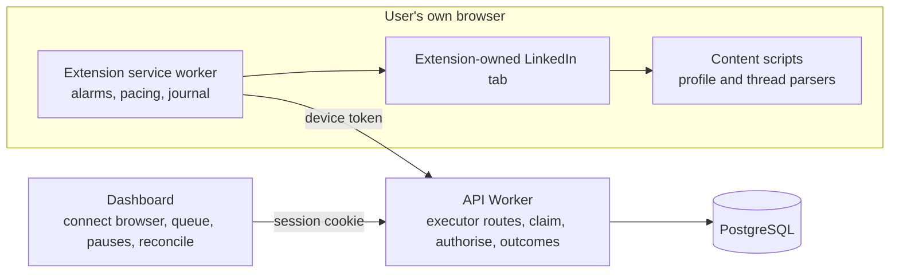

# Controlled execution in the user's browser

Status: proposed, 4 November 2026. Nothing in this document is implemented; sending remains disabled until the implementation status section says otherwise.

## Problem and boundaries

The product promise is the one in the [brief](../product/brief.md): a user imports people from a LinkedIn search, approves an invitation note and a short message sequence, and Paced then sends on the user's behalf, a few invitations a day at a human pace, the first message once an invitation is accepted, and the follow-ups unless the person replies. All of this happens in the user's own signed-in browser, never from a cloud browser. The [execution contract](api-execution.md) and [ADR-0004](../decisions/0004-send-reconciliation.md) already define how a send is claimed, authorised, journaled and reconciled. This design turns that contract into an extension and a server path, phase by phase, so that each capability is proved before the next one is enabled.

- **Included:** pairing the extension with the workspace as a revocable executor; a background service worker that works only while the browser is open; observation of a person's profile and message thread (connection state, message direction and time, never message bodies); controlled invitation and message sending with a pacing policy; automatic pause on any LinkedIn limit or warning; the dashboard controls to connect a browser, watch progress and resolve an uncertain send.
- **Excluded:** cloud browsers, Sales Navigator, InMail, bulk or "open profile" style actions, reading or storing message bodies, scraping beyond the enrolled people, and anything that runs while the user's browser is closed.
- **Policy:** LinkedIn's user agreement prohibits unauthorised automation. A human pace and daily caps reduce the chance of restriction; they do not remove it, and no setting in this product is a safety guarantee. Each user enables sending for their own account knowingly, and the product pauses itself the moment LinkedIn shows a limit, a warning or a verification step.

Confirmed facts: the database already has the action, attempt, lease, reservation and result tables with the contract's states, and a coordination function that issues 60-second fenced leases; the import binds an account to one LinkedIn identity; the extension already parses search rows from visible text only; the NFR budget allows an idle extension poll at most once per five minutes. Unproved and to be established in phase X0: how reliably the profile page exposes the connection state, how completely a thread can be read, and whether a send can be confirmed from the page.

## Design

### Capability phases

Each phase is a separate gate with its own evidence. A later phase is never enabled on an account before the earlier one has passed on that account type.

| Phase | Capability                                                                                                                                                         | Evidence that opens the next phase                                                                         |
| ----- | ------------------------------------------------------------------------------------------------------------------------------------------------------------------ | ---------------------------------------------------------------------------------------------------------- |
| X0    | Pairing and observation only: the extension reads enrolled people's profile state and thread metadata on a daily cadence and reports observations; nothing is sent | Observations agree with the user's own knowledge over a shadow period; parser failure rate is known        |
| X1    | Automated invitation with the approved note, within the pacing policy                                                                                              | Each send confirmed from the page as Pending; no duplicate; auto-pause triggers verified on a limit dialog |
| X2    | Acceptance detected from the profile, first message sent after the configured delay once the thread shows no incoming message since enrollment                     | Acceptance and reply observations agree with reality; message confirmed in the thread as ours              |
| X3    | Follow-ups with reply detection before each one                                                                                                                    | Replies stop the sequence before the next step every time in the shadow comparison                         |

### Executor pairing

The dashboard offers **Connect this browser**. The server creates a one-time eight-character code valid for five minutes. The user enters it in the extension's options page; the extension exchanges it for a device token (random 256-bit value, stored hashed in a new `sequence_private.executors` table with workspace, account, adapter version, created, last-seen and revoked times) and keeps the token in `chrome.storage.local`. The dashboard lists connected browsers with last-seen time and a **Disconnect** button; revocation stops claims immediately and holds any in-flight attempt for reconciliation. The token never grants dashboard access; it is accepted only on `/api/executor/*` routes, which the Pages proxy forwards like any other API path. Executor routes allow the extension's own origin and nothing else.

### Extension changes

- Host matches grow from the people-search page to `https://www.linkedin.com/in/*` and `https://www.linkedin.com/messaging/*`. No other site.
- A service worker uses `chrome.alarms` every five minutes with jitter while the browser is open, asks the server for due work for its account, and runs at most one action at a time. It survives worker restarts because every step is journaled in IndexedDB before it happens.
- Actions run in one tab the extension creates and owns (pinned, not focused). The user can look at it at any time; the extension never acts in a tab the user is using.
- Content scripts for the profile and thread pages are pure visible-text parsers like the search parser, with fixtures for every observed layout. They return typed observations, never raw HTML.
- Pacing lives in the service worker and is also enforced by the server, so a modified extension cannot exceed the account's limits.

### Observation (phase X0)

For each enrolled person, at most once per day plus immediately before any action: open the profile, read the visible connection state (Connect, Pending, Message, 1st, 2nd, 3rd, or unreadable), and if a thread exists open it and read the direction and time of the newest messages, plus an opaque fingerprint of each so that the same message is never counted twice. An observation is complete when the thread view shows its newest message and every message since the enrollment time is visible; otherwise it is incomplete and the sequence holds for verification. The server validates identity (the bound account, the recipient's key) and freshness before trusting it, exactly as the contract requires. Message bodies never leave the page.

### Action flow (phases X1 to X3)

1. The service worker asks the server to **claim** the next due action for the account. The server locks the sender slot, rechecks approval, enrollment, pauses, caps, spacing and freshness, creates the attempt and lease, and returns the rendered text.
2. The extension opens the profile in its own tab, observes, and runs the preflight: signed-in account matches the bound identity, recipient matches, state allows the action (Connect visible for an invitation; Connected and no incoming message since enrollment for a message), note allowance available when a note is approved.
3. It writes **may-have-sent** to the local journal, then calls **authorize-send**; the server records may-have-sent in the cloud and returns a single-use token valid for ten seconds. No token, no click.
4. It performs the action with human-like timing: a pause of a few seconds after the page settles, the Connect click, **Add a note**, the note entered at a typing pace, **Send**. For a message: the thread, the text, **Send**.
5. It confirms from the page: the profile now shows Pending, or the thread shows our message as the newest outgoing one with a matching fingerprint. Confirmed evidence becomes `ConfirmedSent`; a clear "nothing happened" state with the original button still present becomes `NotSent`; anything else is `OutcomeUnknown`, which holds the account until reconciled.
6. Results are journaled locally first and then submitted; a restart replays unsynced journal entries before any new claim.

### Pacing policy

Defaults, all adjustable per account within an operator ceiling and never above it:

| Setting                             | Default                                                                                                                  |
| ----------------------------------- | ------------------------------------------------------------------------------------------------------------------------ |
| Invitations per day                 | 18, ceiling 20                                                                                                           |
| Invitations per rolling seven days  | 100, which is the limit LinkedIn applies to most accounts                                                                |
| Messages per day                    | 20                                                                                                                       |
| Gap between any two actions         | random, uniform between 5 and 10 minutes                                                                                 |
| Working window                      | 09:00 to 18:00 Monday to Friday in the account's explicit timezone, with a random daily start offset of up to 30 minutes |
| Page visits per day for observation | 60                                                                                                                       |

Counters include confirmed sends and unresolved may-have-sent reservations. After a pause or an offline period the schedule resumes at the next window with the same gaps; there is never a catch-up burst. Sends happen only while the browser is open and the bound account is signed in.

### Automatic pause

The account pauses itself, with the reason shown in the dashboard and no automatic resume, when the extension sees any of: a weekly invitation limit dialog, a "you've reached" or similar warning text, a verification, captcha or sign-in page, a signed-in identity that does not match the bound account, or two consecutive parse failures on a page it needs. The user resumes from the dashboard after reading the reason. Resume revalidates everything, as the lifecycle rules require.

### Dashboard

New: **Connect this browser** with the pairing code and the list of connected browsers; an execution status line (last seen, next planned action time, today's counts against caps); the auto-pause banner with its reason; and a reconciliation control on an uncertain attempt, "I checked LinkedIn: it was sent" or "it was not sent", which is the only manual input in this design and is labelled "reported by you". Everything else that exists today (queue reasons, pause and stop, approval, export, deletion) is unchanged.

### Data changes

A forward migration adds `sequence_private.executors`, the pacing settings and ceilings on `seq_accounts`, an `execution_mode` of `disabled`, `observe` or `send`, and the executor operations behind `seq_manage` or a sibling function restricted to executor tokens: claim, authorize-send, outcome, observations batch, heartbeat. The engine policy gains a gap range and a weekly cap. The existing `sending_enabled` check is replaced by the per-phase mode.

### What stays unchanged

The import path, drafts, approval, the one-active-sequence constraint, pause and stop semantics, export, deletion, backups and quota meters. The search-page part of the extension is unchanged.

## Alternatives, critique and reconciliation

| Concern                                                  | Alternative                                    | Resolution                                                                                                                                        |
| -------------------------------------------------------- | ---------------------------------------------- | ------------------------------------------------------------------------------------------------------------------------------------------------- |
| A cloud browser would work while the user is offline     | Hosted browser sessions                        | Rejected by the brief and the hosted-hybrid decision: it needs LinkedIn credentials or cookies on a server and multiplies the policy risk         |
| Manual mode first would reach users sooner               | A dashboard queue where the user sends by hand | Set aside by the owner on 4 November 2026 in favour of the automated product promise; its reconciliation buttons survive as the only manual input |
| Fixed two-minute spacing from the earlier defaults       | Keep 120 seconds                               | Replaced by a random 5 to 10 minute gap and a weekly cap, which resemble a person and respect LinkedIn's published weekly limit                   |
| LinkedIn's partner APIs would be cleaner                 | Invitations and Messages APIs                  | Not available to this project and they exclude scheduled sends; recorded in the feasibility findings                                              |
| Reading message bodies would make reply detection easier | Store incoming text                            | Never; direction, time and an opaque fingerprint are enough to stop a sequence                                                                    |
| A pasted API key would be simpler than pairing           | Manual token entry                             | A short-lived pairing code avoids long secrets in chat or clipboard and makes revocation per browser                                              |
| Acting in the user's current tab saves a tab             | Reuse any LinkedIn tab                         | The extension owns one tab so the user's own browsing is never interrupted or mistaken for automation evidence                                    |
| Parsers will break when LinkedIn changes                 | Best-effort parsing                            | Every parser reports unreadable states; two failures pause the account; fixtures are kept for each layout seen                                    |
| Pacing could be defeated by a modified extension         | Trust the client                               | The server enforces caps, gaps and the one-sender rule; the client only schedules                                                                 |
| Web Store distribution would ease updates                | Publish now                                    | Deferred; unpacked loading for the pilot, version checked at pairing and on each claim                                                            |

## Planned verification

- Parser fixtures for the profile and thread pages: each connection state, a thread with incoming and outgoing messages, an empty thread, a partially loaded thread, a limit dialog, a verification page, an account mismatch.
- Executor authentication tests: pairing code expiry and single use, token hashing, revocation, origin restriction, no dashboard access with a token.
- Database scenarios: claim, authorize, outcomes and reconciliation across restarts; daily and weekly caps; gap enforcement; working window and timezone; auto-pause and resume; one sender per account under concurrent claims; export and deletion including executors.
- Extension tests with mocked pages for the service worker flow, journal replay after a restart and the human-timing steps.
- End-to-end run with mocked LinkedIn pages in Playwright: pairing, observation, an invitation, an acceptance, a first message, a reply that stops the sequence.
- Shadow period on the owner's account (phase X0): observations compared with the owner's own view of each enrolled person, with the parser failure rate recorded.
- Controlled live test on the owner's account with explicitly agreed recipients: invitations only first, then messages; counts recorded without names or identifiers.

## Implementation status

Not implemented. The next step is the owner's decisions recorded with the story (pacing defaults, shadow period length, first live test scope, pairing and distribution choices), then phase X0.
