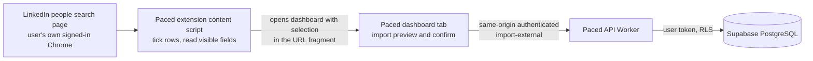

# Browser extension: read-only import from LinkedIn search

Status: implemented, 3 and 4 November 2026; see the implementation status section. Sending remains disabled.

## Problem and boundaries

Paced currently imports only a fixed fictional catalog. For the product to be useful, a user must be able to select real people from an ordinary LinkedIn people search in their own browser and save them into Paced with their selected fields. This design covers that read-only path and nothing more:

- **Included:** a Chrome extension that works only on LinkedIn people-search result pages, lets the user tick rows, reads the visible fields of ticked rows, shows the user exactly what was read, and hands the selection to the Paced dashboard; a dashboard import preview and confirmation for that selection; the database and API changes that store such people with an honest source label and the evidence that came with them.
- **Excluded:** sending invitations or messages, reading conversations or inboxes, opening profiles automatically, scrolling or paging automatically, reading pages the user did not open, background activity, and any storage of LinkedIn passwords, cookies or tokens.

Confirmed facts from earlier bounded observations (2 and 14 October 2026): search rows expose display name, headline, location, a relationship label and a public profile link; a candidate stable key of the form `urn:li:fsd_profile:…` was readable on profile pages and stayed equal on revisit; hidden text can contradict visible text, so only visible evidence counts. Whether the same key is exposed on search rows, and how reliably fields parse, is unverified and is the first thing this work must establish.

LinkedIn's user agreement restricts automated activity. This extension performs no automation: it reads only the page the user is looking at, only for the rows the user ticked, only when the user clicks. That keeps it in the same category as a user copying text by hand, but the policy risk is not zero and is stated in the product documentation.

## Design

### Extension

- Manifest V3, TypeScript, built with Vite into `apps/extension/dist`. Loaded as an unpacked extension by pilot users; no Web Store publication.
- One content script, matched only on `https://www.linkedin.com/search/results/people/*`. No background service worker, no `storage`, `tabs`, `cookies` or network permissions. The extension never calls LinkedIn or Paced endpoints.
- On a search page the script adds a checkbox to each result row and a small Paced panel with a count and a **Send to Paced** button. Nothing is read until the button is clicked.
- The parser is a pure module, `parseResultRow(element)`, that returns a typed record from one row: display name, headline, location, relationship label, public profile path, the `fsd_profile` key when present in the row's links, the visible primary action label (Connect, Pending, Message, Follow, other) and a `missing` list for anything absent. It reads only visible text (elements with a non-zero bounding box) and never innerHTML. It is unit-tested on synthetic HTML fixtures that reproduce the observed layouts, including hidden-text traps.
- The panel also reads the signed-in identity from the page's own navigation (self profile path and, when present, the self `fsd_profile` key). This is sent with the selection so the server can bind the account and refuse a selection made in a different LinkedIn account.
- **Send to Paced** builds a payload (`contract: "paced-selection-1"`, extension version, captured time, page type, self identity, up to 100 rows) and opens `https://sequence-dev-etj.pages.dev/#selection=<base64url JSON>` in a new tab. The fragment never reaches any server; the dashboard reads it from `location.hash` and clears it immediately. The payload is at most about 40 KB.
- The panel shows exactly which fields were read for the ticked rows before the user clicks, and a notice that nothing is sent to LinkedIn.

### Dashboard

- On load, if `#selection=` is present and the user is admitted, the dashboard decodes it, validates it against the shared schema, clears the fragment and shows **Import from LinkedIn selection**: a table of the rows with their fields, missing values and duplicates, the self identity, and a list name. Confirm calls the API; nothing is imported on arrival.
- Rows whose profile key is missing are shown but cannot be imported, because the product never links people by name alone.

### API and database

- A forward migration widens `seq_prospects.source` to allow `extension-v1` and binds the LinkedIn account on first external import: `seq_accounts.external_identity` becomes `linkedin:<self key>`; `identity_verified_at` stays null because the extension's reading is not independent verification. A later import whose self identity differs is rejected with an account-mismatch error; nothing is silently rebound.
- `seq_manage` gains `import-preview-external` and `import-external`. Validation: contract version, extension version pattern, captured time within 24 hours, 1 to 100 rows, each row's key matching the `fsd_profile` pattern, field lengths, no duplicate keys, the 1,000-prospect limit, and the account identity rule above. Dedup is by account and profile key; an existing person is reused and added to the new list, and changed visible fields update the profile (which invalidates affected approvals, as today).
- Each imported row also records an observation with `observer_version = "extension-v1"`, the captured time as `observed_at`, `complete = false`, and the connection state mapped from visible evidence: relationship `1st` means Connected; action `Pending` means Pending; action `Connect` with a non-first relationship means NotConnected; anything else means Unknown. No reply or withdrawal state is ever derived from a search row.
- Approval and enrollment accept `extension-v1` prospects with the same dispositions as today: Connected excluded, Pending waiting, Unknown held for verification, NotConnected held because execution is disabled. The management snapshot and export carry the source so the UI can label real people as "from LinkedIn (unverified)".

### What stays unchanged

Sending, observation sync, executor registration, leases and reconciliation remain out of scope and disabled. The extension has no authority and no credential; the dashboard session is the only authenticated party. Quota meters, export, deletion and backups treat these prospects like any other.

## Alternatives, critique and reconciliation

| Concern                                                                                               | Alternative                               | Resolution                                                                                                                                                       |
| ----------------------------------------------------------------------------------------------------- | ----------------------------------------- | ---------------------------------------------------------------------------------------------------------------------------------------------------------------- |
| Extension calling the Paced API directly needs its own credential and would bypass same-origin checks | Register the extension as an executor now | Hand the selection to the dashboard through the URL fragment; the authenticated dashboard imports. Executor credentials belong to the controlled-execution story |
| Clipboard copy-paste is awkward and can leak into clipboard history                                   | Clipboard transfer                        | URL fragment, cleared on arrival, never sent to a server                                                                                                         |
| A search row may not expose the stable key                                                            | Link by vanity path or name               | Rows without a key are shown but not importable; the first implementation step measures key availability on the owner's account                                  |
| Hidden text misled an earlier observation                                                             | Trust innerText                           | Visible-only reads with bounding-box checks and fixture tests for hidden traps                                                                                   |
| LinkedIn layout changes break the parser silently                                                     | Best-effort parsing                       | Every row reports its missing fields; a row with no name or no key is flagged, and the panel shows a layout warning when fewer than half the rows parse          |
| A user could import from a second LinkedIn account                                                    | Allow and merge                           | Self identity travels with the selection; a mismatch is rejected and reported                                                                                    |
| Extension permissions could grow into automation                                                      | Broad host permissions                    | Only the people-search match pattern, no background worker, no network, no storage                                                                               |

## Planned verification

- Unit tests for the parser on synthetic fixtures: full row, missing headline or location, hidden `1st` next to visible `2nd`, no key, Pending and Follow actions, two accounts' self identity.
- Contract tests for the selection schema (dashboard and API share it).
- Database scenarios: external import with dedup and list membership, account binding on first import, mismatch rejection, key pattern and limit enforcement, observation rows, approval dispositions for each mapped state, export and deletion including these rows.
- Dashboard tests: fragment decoding, fragment cleared, preview with missing keys not importable, confirm request shape.
- Accessibility suite extended with the preview screen.
- Owner-run feasibility check on the owner's own account within the bounds already accepted for this story (Microsoft + Software Engineer search, at most two pages, five selected people): count of rows with a readable key, fields present, and a successful import of the selected people into a named list. Results are recorded as anonymized counts and presence tables only.

## Implementation status

Implemented: the selection contract and fragment codec in `packages/shell-contracts`, the extension in `apps/extension` (manifest, visible-only parser with fixture tests, content script with account-menu identity detection), migration `202611030014_external_import.sql`, the dashboard preview and confirmation, and the management contract changes.

Findings from the live layout that changed the design above: search rows expose `urn:li:member:<digits>` in a `componentkey` attribute on Connect links only, and no `fsd_profile` key; the parser accepts both namespaces, and rows without a key (Follow rows) are shown but not importable. The signed-in identity is readable only from the opened account menu as a profile path, so the server binds by path when no key is available. Result cards use `display: contents` wrappers and are wrapped in a profile link, so visibility is decided per text node and the display name is the shortest visible profile-link text in the row.

A selection that arrives while the dashboard is signed out is kept in the tab's session storage until it is imported or discarded, so the sign-in redirect does not lose it. An end-to-end run on a pilot account completed: three rows parsed with every field and a stable key, preview, import into a named list, and a second preview reporting the bound account and existing people.
